# Data Platform Knowledge Assistant

[](https://github.com/vivekdatla96/data-platform-knowledge-assistant/actions/workflows/ci.yml)


-FF9900)

A retrieval-augmented generation (RAG) assistant that answers questions about **ETL mappings,
warehouse metadata, data lineage and operational runbooks**, and cites the exact source section
behind every answer. When the evidence is not good enough it says so instead of guessing.

> **Portfolio demonstration.** Everything in `data/` is synthetic: a fictional retail warehouse
> (`DEMO_DW`) with Snowflake-style metadata, Informatica-style mapping exports and Markdown
> runbooks. The JSON and XML formats are simplified stand-ins defined by this project. There is
> **no live Snowflake or Informatica connection**, and no employer or personal data.

```text
Q: Which downstream objects depend on DW.FACT_ORDERS?
- Upstream DW.FACT_ORDERS feeds downstream DW.FACT_RETURNS through m_RETURNS_STG_TO_FACT_RETURNS (lookup LKP_FACT_ORDERS). [S1]
- Upstream DW.DIM_CUSTOMER feeds downstream DW.FACT_ORDERS through m_ORDERS_STG_TO_FACT_ORDERS (lookup LKP_DIM_CUSTOMER). [S2]
- Upstream DW.FACT_ORDERS feeds downstream MART.DAILY_SALES through view definition. [S3]
  [S1] snowflake/lineage.json :: lineage:DW.FACT_ORDERS->DW.FACT_RETURNS
  [S2] snowflake/lineage.json :: lineage:DW.DIM_CUSTOMER->DW.FACT_ORDERS
  [S3] snowflake/lineage.json :: lineage:DW.FACT_ORDERS->MART.DAILY_SALES

Q: What is the Snowflake account URL for production?
ABSTAINED: Insufficient evidence: best similarity 0.67 (min 0.68), question-term coverage 0.34 (min 0.30).
```

*(Output of the offline extractive mode, which quotes evidence and uses no LLM. In this example
S2 is an upstream edge of `FACT_ORDERS`, not a downstream one: the offline mode ranks by word
overlap and does not reason about direction.)*

## What is implemented, and what is not

| Area | Status |
|---|---|
| Ingestion of synthetic Snowflake metadata + lineage (JSON), Informatica-style mappings (XML), Markdown runbooks | **Implemented and tested** |
| Validation, deterministic chunk IDs, provenance, incremental re-ingest, update and delete handling | **Implemented and tested** |
| Local semantic retrieval: open-source `BAAI/bge-small-en-v1.5` (ONNX, CPU) + SQLite vector store, hybrid BM25 fusion | **Implemented and tested** |
| Offline answer mode (extractive, no LLM, no API cost) | **Implemented and tested** |
| AWS Bedrock generation (Converse API, configurable model) | **Implemented; tested only against stubbed AWS responses.** No live Bedrock call was made during development. |
| Citation verification, abstention, untrusted-content handling | **Implemented and tested.** The injection detector is a regex heuristic, not a security guarantee; see [Trust boundaries](#trust-boundaries). |
| Web UI + JSON API, CLI, Docker image, GitHub Actions CI | **Implemented and tested.** CI runs lint, tests on Python 3.10 and 3.12, a real-model evaluation, and a Docker build with a container smoke test (see [Verification status](#verification-status)). |
| Pulling metadata live from Snowflake (`INFORMATION_SCHEMA`, `ACCESS_HISTORY`) | **Proposed, not implemented** |
| Pulling mappings from an Informatica repository or IDMC API | **Proposed, not implemented** |
| AWS hosting (ECS Fargate / App Runner, S3 corpus, OpenSearch or pgvector) | **Proposed, not deployed** |

## Architecture

```mermaid
flowchart LR
    subgraph Sources["data/corpus (synthetic, read-only)"]
        SF[Snowflake-style metadata<br/>+ lineage JSON]
        INF[Informatica-style<br/>mapping XML]
        RB[Markdown runbooks]
    end
    Sources --> V[Validate<br/>pydantic / defusedxml]
    V --> C[Structure-aware chunks<br/>id = sha256 of doc + locator]
    C --> M{Changed?<br/>content hash}
    M -- new / updated --> E[Embed<br/>bge-small-en-v1.5, ONNX]
    M -- unchanged --> SKIP[skip]
    E --> DB[(SQLite index<br/>vectors + text + provenance)]
    M -- file deleted --> DEL[delete chunks] --> DB
    Q[Question<br/>UI / API / CLI] --> RET[Hybrid retrieval<br/>cosine + BM25, RRF]
    DB --> RET
    RET --> G{Abstention gate<br/>similarity + term coverage}
    G -- fail --> AB[Abstain + show evidence]
    G -- pass --> P[Provider<br/>offline extractive or AWS Bedrock]
    P --> CV[Citation check<br/>labels must match evidence]
    CV --> ANS[Answer + citations + evidence]
```



Design choices and tradeoffs (embedding model, vector store, hybrid retrieval, abstention,
prompt-injection handling) are in [docs/ARCHITECTURE.md](docs/ARCHITECTURE.md).

## Quick start

Requires Python 3.10+. The first `dpka ingest` (or first use of the real model) downloads
`BAAI/bge-small-en-v1.5` from Hugging Face (64 MB measured) into fastembed's cache. Set
`FASTEMBED_CACHE_PATH` to choose the folder; after that everything runs offline.

```bash
python -m venv .venv
source .venv/bin/activate          # Windows: .venv\Scripts\activate
pip install -e ".[dev]"

dpka ingest                        # build .dpka/index.sqlite from data/corpus
dpka ask "Is it safe to rerun a failed FACT_ORDERS session?"
dpka serve                         # UI at http://127.0.0.1:8000
```

The complete demonstration (ingest, re-ingest, sample questions, abstention, injection handling,
an update and a deletion) runs on a temporary copy of the corpus:

```bash
python scripts/demo.py
```

Tests and evaluation:

```bash
pytest                               # unit tests, no network (hashing embedder, stubbed Bedrock)
DPKA_RUN_MODEL_TESTS=1 pytest        # also runs tests with the real embedding model
dpka eval                            # retrieval + abstention metrics on data/eval/questions.jsonl
```

> On Windows, very long folder paths (over 260 characters) can make Python skip files. Clone into
> a short path or enable Windows long-path support.

## Sample questions

| Category | Question |
|---|---|
| Incremental loads | How does the FACT_ORDERS incremental load decide which source rows to extract? |
| Incremental loads | How do I backfill FACT_ORDERS for a past date range? |
| Failed ETL jobs | What should I do when an ETL session fails with a statement timeout? |
| Failed ETL jobs | Who do I escalate to if the same session fails twice in a row? |
| Source-to-target mappings | How is NET_AMOUNT calculated in FACT_ORDERS? |
| Source-to-target mappings | Which attributes are tracked as SCD Type 2 in DIM_CUSTOMER? |
| Warehouse lineage | Which downstream objects depend on DW.FACT_ORDERS? |
| Warehouse lineage | Where does the ORDER_SK in FACT_RETURNS come from? |
| Should abstain | What is the Snowflake account URL for production? |
| Prompt-injection fixture | What do the partner notes say about the returns feed? |

## Configuration

All settings are environment variables with the `DPKA_` prefix; see [.env.example](.env.example).
The defaults run the offline demo.

| Variable | Default | Meaning |
|---|---|---|
| `DPKA_CORPUS_DIR` | `data/corpus` | Folder to ingest (read-only) |
| `DPKA_INDEX_PATH` | `.dpka/index.sqlite` | SQLite index file |
| `DPKA_EMBEDDING_BACKEND` | `fastembed` | `fastembed` or `hashing` (tests only) |
| `DPKA_RETRIEVAL_MODE` | `hybrid` | `hybrid` or `dense` |
| `DPKA_TOP_K` | `5` | Evidence chunks per question |
| `DPKA_MIN_RELEVANCE` / `DPKA_MIN_COVERAGE` | `0.68` / `0.3` | Abstention gate |
| `DPKA_LLM_PROVIDER` | `offline` | `offline` or `bedrock` |
| `DPKA_BEDROCK_MODEL_ID` | (none) | Required for Bedrock: model ID, inference profile ID, or ARN |
| `DPKA_LLM_TEMPERATURE` | (unset) | Optional; omitted from the request unless set |
| `DPKA_AWS_REGION` | `us-east-1` | Bedrock region |

### Using AWS Bedrock

```bash
pip install -e ".[bedrock]"
export DPKA_LLM_PROVIDER=bedrock
export DPKA_BEDROCK_MODEL_ID=<model ID, inference profile ID, or inference profile ARN enabled in your account>
export AWS_PROFILE=<your profile>   # standard AWS credential chain; no keys in this repo
dpka ask "How do I backfill FACT_ORDERS for a past date range?"
```

Bedrock calls are billed by AWS. The IAM principal needs `bedrock:InvokeModel` on the chosen
model. If Bedrock fails (credentials, throttling, timeout, guardrail), the response has
`status: "generation_failed"` and still includes the retrieved evidence.

## Trust boundaries

* **Retrieved documents are untrusted data.** The app gives the model no tools, sends no
  `toolConfig`, never executes model output, and puts evidence in delimited blocks in the user
  turn rather than in the system prompt. Retrieved text therefore cannot trigger actions or
  replace the system instructions.
* **Injection detection is a heuristic.** A regex detector flags instruction-like text (for
  example the planted fixture in `runbooks/partner_returns_feed.md`). It catches common phrasings
  and will miss paraphrased or encoded attacks. It is a visibility aid, not a control.
* **A valid citation is not proof of support.** Every `[S#]` is checked against the evidence that
  was actually retrieved, and unknown IDs are stripped. That shows *where* a claim points, not
  that the source says it: a sentence can cite the right chunk and still misstate it. A
  word-overlap check adds warnings, but the reliable check is reading the cited evidence, which
  every response includes.

## API

| Method | Path | Description |
|---|---|---|
| `GET` | `/` | Single-page UI: question, answer with clickable citations, retrieved evidence |
| `GET` | `/api/health` | Index statistics, provider, sample questions |
| `POST` | `/api/ask` | `{"question": "...", "top_k": 5}` returns `status`, `answer`, `citations`, `evidence`, `gate`, `warnings` |

`status` is `answered`, `abstained` or `generation_failed`. Each citation carries `chunk_id`,
`doc_id`, `locator` and, for runbooks, line numbers.

## Docker

```bash
docker compose up --build          # http://localhost:8000
```

The image installs the package, downloads the embedding model at build time, runs as a non-root
user, re-ingests incrementally on start, and serves the UI. To use Bedrock, put the `DPKA_*`
settings in `.env` and provide AWS credentials through the environment or a task role.

## Deployment (proposed; not deployed by this project)

A reasonable path to AWS, written as guidance rather than a tested runbook:

1. Push the image to Amazon ECR.
2. Run it on ECS Fargate or App Runner behind an ALB with authentication (Cognito or the
   company IdP). The API has no authentication of its own.
3. Give the task role `bedrock:InvokeModel` for one model and read-only access to an S3 prefix
   that holds the corpus. Sync that prefix into `DPKA_CORPUS_DIR` before `dpka ingest`.
4. Run ingestion as a scheduled task (EventBridge) rather than at container start once the
   corpus grows.
5. For multi-user scale, replace the SQLite store with OpenSearch Serverless (vector engine) or
   Aurora PostgreSQL with pgvector. For Snowflake-native search, Cortex Search is an option.
6. Replace the synthetic JSON exporters with real extractors: Snowflake `INFORMATION_SCHEMA`
   and `ACCESS_HISTORY` / `OBJECT_DEPENDENCIES` for metadata and lineage, and the Informatica
   repository or IDMC REST API for mappings. Both need read-only service accounts and a review
   of what metadata may leave the warehouse.

## Evaluation

Measured on 2026-10-31 with `bge-small-en-v1.5`, the offline provider and k = 5. Full details,
per-question output and caveats are in [docs/EVALUATION.md](docs/EVALUATION.md).

| Retrieval | Set | Hit@1 | Recall@5 | MRR | Answerable answered | Unanswerable abstained |
|---|---|---|---|---|---|---|
| hybrid | dev (26 + 8) | 0.92 | 0.96 | 0.96 | 1.00 | 1.00 |
| hybrid | holdout (8 + 4) | 1.00 | 1.00 | 1.00 | 0.75 | 1.00 |
| dense | dev (26 + 8) | 0.88 | 0.94 | 0.93 | 1.00 | 1.00 |
| dense | holdout (8 + 4) | 0.75 | 1.00 | 0.88 | 0.88 | 1.00 |

The abstention thresholds were tuned on the dev set, so its 1.00 / 1.00 is in-sample. On the
holdout set the gate wrongly abstained on 2 of 8 answerable questions. Both sets are small and
author-written over a 12-document synthetic corpus, so they are a regression baseline, not a
benchmark. No live LLM answer quality was measured.

## Verification status

Run on 2026-10-31 from a clean copy of the project (Windows 11, Python 3.11.18): a new `venv`,
`pip install -e ".[dev]"`, and an empty, isolated model cache (`FASTEMBED_CACHE_PATH`).

| Check | Result |
|---|---|
| `ruff check` / `ruff format --check` | clean |
| `pytest` (default) | 66 passed, 2 skipped (the real-model tests, opt-in) |
| `DPKA_RUN_MODEL_TESTS=1 pytest` | 68 passed (model downloaded on first use: 64.1 MB) |
| `dpka ingest` twice | 12 added / 54 chunks, then 12 unchanged / 0 embedded |
| `python scripts/demo.py` | completed; update re-embedded 1 chunk, deletion removed the mapping from results |
| `dpka eval` (dev and holdout) | numbers in [Evaluation](#evaluation) |
| API smoke test (`dpka serve`, real HTTP) | `/api/health`, `/api/ask` (answered and abstained), 422 on empty input, UI `GET /` 200 |

GitHub Actions ([first run](https://github.com/vivekdatla96/data-platform-knowledge-assistant/actions/runs/41232054172),
commit `964e5f2`, Ubuntu): all four jobs passed.

| Job | Result |
|---|---|
| `test (3.10)`, `test (3.12)` | lint clean; 66 passed, 2 skipped (real-model tests are opt-in) |
| `model-eval` (Python 3.11) | real-model tests 2 passed; ingest, both evaluations and the demo completed with the same numbers as the local runs, including the two holdout misses |
| `docker` | image built; container ingested 12 documents / 54 chunks, `/api/health` responded, and `/api/ask` returned `answered` for the smoke-test question |

Docker was verified only in CI (Linux); the Docker engine was not available on the Windows
development machine.

Not verified:

* **AWS Bedrock: mocked only.** The provider is tested against botocore `Stubber` responses
  (request shape, inference profile ARN, optional temperature, throttling, access denied,
  model timeout, guardrail and context-window stops, empty output). No live Bedrock call was
  made.
* **Snowflake / Informatica:** no connection exists; only synthetic files are ingested.

## Project layout

```text
src/dpka/
  loaders.py      format parsers + validation (JSON, XML, Markdown)
  ingest.py       incremental ingestion: add / update / delete / last-known-good
  store.py        SQLite vector store with provenance
  embeddings.py   fastembed (bge-small) and the test-only hashing embedder
  retrieval.py    dense, BM25, hybrid (RRF), question-term coverage
  prompting.py    system prompt and delimited evidence
  providers.py    offline extractive provider, AWS Bedrock provider
  citations.py    citation parsing and verification
  assistant.py    retrieve -> gate -> generate -> verify
  safety.py       prompt-injection markers and delimiter neutralization
  evaluation.py   retrieval and abstention metrics
  api.py, static/ FastAPI app and UI
  cli.py          dpka ingest | ask | eval | stats | serve
data/corpus/      synthetic sources (snowflake/, informatica/, runbooks/)
data/eval/        labeled dev and holdout questions
tests/            pytest suite
scripts/demo.py   end-to-end local demonstration
docs/             architecture, evaluation and raw results
```

## License

MIT. The synthetic data in `data/` is original to this project.
