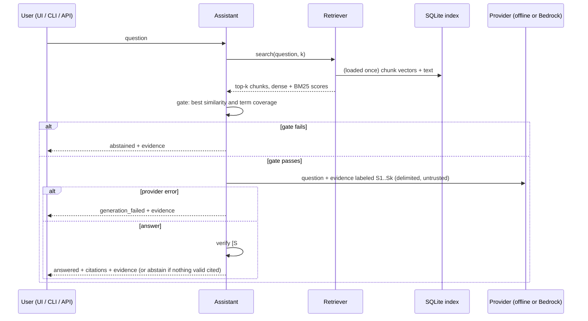

# Architecture and design decisions

## Pipeline

## Ingestion

| Concern | Implementation |
|---|---|
| Formats | `.json` (synthetic Snowflake metadata or lineage), `.xml` (synthetic Informatica-style mapping), `.md` (runbook). Formats are versioned (`dpka.*.v1`) and declared in each file. |
| Validation | Pydantic models with `extra="forbid"` for JSON; required elements and attributes for XML; a title heading for Markdown; a 2 MB size limit. XML is parsed with `defusedxml` (no entity expansion, no external entities). |
| Chunking | Structure-aware: one chunk per table, per lineage edge, per mapping section (overview / transformations / field mappings), per Markdown section (split further on blank lines above 1,800 characters). Fenced code is kept inside its section. |
| Chunk IDs | `sha256(doc_id + "::" + locator)[:20]`, where the locator is structural (`table:DW.FACT_ORDERS`, `section:Rerunning a failed run`). IDs stay stable when text changes; `content_hash` tracks the text. |
| Provenance | Every chunk stores `doc_id` (path relative to the corpus root), `doc_type`, `locator`, Markdown line range, content hash and ingest timestamp. |
| Repeatability | A file whose SHA-256 is unchanged is skipped without parsing. A changed file is re-parsed; chunks with the same ID and hash reuse their stored embedding; the document is replaced in one transaction. Files missing from disk are deleted from the index. |
| Bad edits | A file that fails validation is reported. If an earlier version was indexed it is kept ("last known good"), so one malformed edit cannot silently remove a document. |
| Model safety | The index records the embedding model name and dimension; ingesting or querying with a different name or dimension raises an error until `--rebuild`. Document writes validate matrix shape, finite float32 values, chunk count and document ownership before changing stored data. Rejected writes preserve the existing document. |
| Source data | The corpus directory is only read. A test hashes the bundled corpus before and after two ingests. |

## Embeddings: `BAAI/bge-small-en-v1.5` via fastembed

| Option | Why / why not |
|---|---|
| **bge-small-en-v1.5 via fastembed (chosen)** | Open-source (MIT), 384 dimensions, about 70 MB, runs on CPU through ONNX Runtime without PyTorch. Fast enough to embed this corpus in seconds and to fit a slim Docker image. |
| Larger open models (bge-base/large, e5-large) | Better quality on hard queries, but 3 to 10 times the size and latency. Worth trying if eval recall drops on a larger corpus. |
| Hosted embeddings (Bedrock Titan, OpenAI) | No local model, but every ingest and query costs money and sends text to a third party. Kept out of the default path. |
| Hashing embedder (included) | Deterministic and dependency-free, used only so unit tests and CI run offline. It has no semantic understanding and is labeled as such. |

## Vector store: SQLite + NumPy (exact search)

| Option | Tradeoff |
|---|---|
| **SQLite + NumPy (chosen)** | One file holds vectors, text and provenance, so updates and deletes are transactional with the manifest. Search is exact cosine over an in-memory matrix: at 10k chunks x 384 dims that is about 15 MB and a single matrix-vector product. No server, trivial to inspect and rebuild. |
| Chroma / LanceDB / FAISS | Approximate indexes scale to millions of vectors. They add a dependency and a second source of truth to keep in sync with the manifest; not needed at this size. |
| pgvector / OpenSearch / Snowflake Cortex Search | The production direction: shared, access-controlled, managed. See the proposed AWS/Snowflake integration in the README. |

The `VectorStore` class is small and isolated, so swapping it means re-implementing
`replace_document`, `delete_document` and `load_all` (or a `search` method) against a new
backend.

## Retrieval

* **Dense:** cosine similarity between the query embedding (with the BGE query instruction
  prefix) and chunk embeddings.
* **BM25:** over lightly stemmed tokens. Identifiers are indexed both whole and split, so
  `FACT_ORDERS` matches `fact_orders`, `fact` and `orders`.
* **Hybrid (default):** reciprocal rank fusion (k = 60) of the two rankings. A chunk with no
  keyword overlap gets no BM25 credit. On the dev set this improved Hit@1 from 0.88 to 0.92 over
  dense only (see [EVALUATION.md](EVALUATION.md)).

## Abstention

Two signals, both shown in every response under `gate`:

1. **Best dense similarity** among the retrieved chunks (default minimum 0.68).
2. **Question-term coverage:** IDF-weighted share of the question's content words that appear in
   the retrieved text. Words that never occur in the corpus get the highest weight (minimum 0.30).

After the gate, the provider can still answer `INSUFFICIENT_EVIDENCE`, and an answer that cites no
retrieved evidence is withheld. The thresholds are tuned on the dev set and are known to
over-abstain on the holdout set.

## Generation and citations

* Evidence is labeled `S1..Sk` and wrapped in `<evidence id=... source=... locator=...>` blocks.
  Any `<evidence`, `<system` or `<assistant` tags inside document text are neutralized, so a
  document cannot close its own block.
* The system prompt says evidence is untrusted data, requires `[S#]` citations on every factual
  sentence, and defines the exact abstention token.
* After generation, every `[S#]` is checked against the labels that were actually sent. Unknown
  labels are removed and reported. If no valid citation remains, the answer is withheld.
  Sentences without a citation, or whose content words barely overlap the cited chunk, produce
  warnings.
* **Offline extractive provider:** picks up to 3 evidence sentences with the highest overlap with
  the question and cites each one. It never paraphrases. Paragraphs containing injection markers
  are skipped entirely.
* **Bedrock provider:** Converse API. `DPKA_BEDROCK_MODEL_ID` takes whatever the Converse
  `modelId` field accepts: a base model ID, an inference profile ID or ARN, or a provisioned /
  custom model ARN. Timeouts and retries go through botocore (`standard` retry mode).
  `inferenceConfig` always carries `maxTokens`; `temperature` is sent only when
  `DPKA_LLM_TEMPERATURE` is set, because supported sampling parameters vary by model. Client
  errors (throttling, access denied, validation, model timeout), missing credentials, network
  timeouts, guardrail or content-filter stops, malformed output, context-window overflow and
  empty responses all become a `ProviderError`, and the API returns the retrieved evidence with
  `status = generation_failed` instead of failing.

## Untrusted content

Retrieved documents are treated as untrusted data. The main boundary is architectural: **the
application exposes no tools or actions to the model.** It does not send `toolConfig` to Bedrock,
never executes model output, never runs SQL, and only renders answers as text (the UI builds the
page from text nodes and never parses retrieved or generated text as HTML). Retrieved content
therefore cannot authorize tool execution, and it is placed in the user turn inside delimited
evidence blocks, never in the system prompt, so it cannot replace the system instructions.

On top of that boundary there are layered heuristics, none of which is a security guarantee:

* a **regex-based injection detector** that flags chunks at ingest time (shown in the UI and in
  API warnings). It catches common phrasings such as "ignore previous instructions" and misses
  paraphrases, other languages, encodings and anything subtle;
* paragraph exclusion of flagged text in the offline extractive mode;
* neutralization of `<evidence>` / `<system>` / `<assistant>` tags inside document text;
* system-prompt instructions telling the model to treat evidence as data. A model can still be
  influenced by injected text in ways these checks do not detect;
* citation verification after generation.

The corpus includes a deliberate injection fixture (`runbooks/partner_returns_feed.md`), and tests
assert that its payload never appears in offline answers. That test does not cover how a live LLM
would respond to the same text.

## Known limitations

* The extractive provider can only quote. It sometimes picks a correct but less useful sentence,
  and it cannot combine facts across chunks.
* Abstention thresholds are corpus- and model-specific and overfit to the small dev set.
* A valid citation ID proves only that the answer points at a chunk that was actually retrieved.
  It does not prove the sentence is supported by that chunk. The lexical-overlap check flags
  sentences that share few words with their cited chunk, but a sentence can reuse the chunk's
  words and still misstate it (wrong number, inverted direction, negation). Read the cited
  evidence, which the UI and API always return.
* No authentication, rate limiting or multi-tenant access control on the API: it is a local demo.
* All source formats are simplified synthetic stand-ins. There is no Snowflake or Informatica
  connector.
